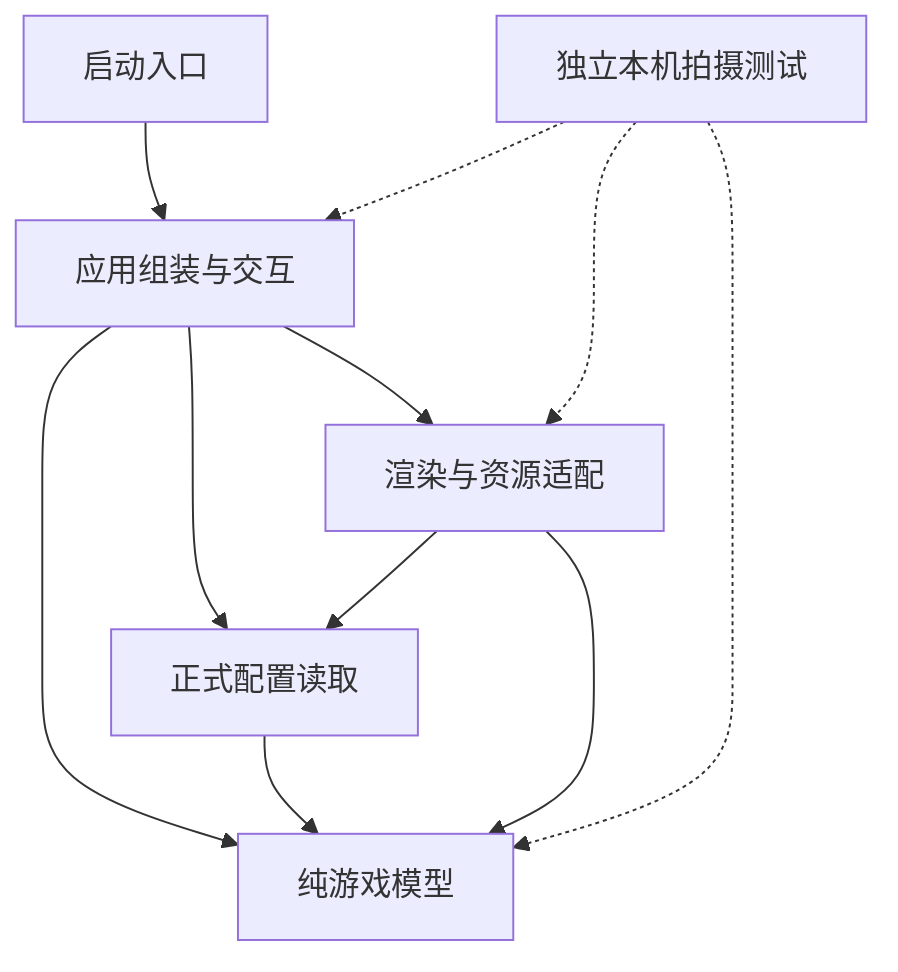

# 游戏架构与边界

正式代码为可安装的 `hero_game` 包，依赖方向为应用组装→模型和渲染；模型不导入pygame、应用、视频场景或素材加载器。

箭头表示调用或依赖。应用工厂负责读取缺省数据并注入；拍摄测试场景只向主体调用。



```text
hero-clock-out/
├── main.py、dialogue.py             源码入口与对白兼容导出
├── hero_game/
│   ├── __main__.py                  安装包模块入口
│   ├── app/
│   │   ├── cli.py                   参数与设备初始化
│   │   ├── game_factory.py          create_game应用装配
│   │   ├── application.py           Application主循环
│   │   ├── input_controller.py      InputController输入
│   │   └── audio.py                 LandingAudio声音适配
│   ├── model/
│   │   ├── game.py                  Game一局状态与流程
│   │   ├── actor.py                 Actor角色运动与墙面时间查询
│   │   ├── dash_skill.py            DashSkill闪身与两次恢复计时
│   │   ├── opening_sequence.py      OpeningSequence阶段状态
│   │   ├── ending_sequence.py       EndingSequence单向过门与安全区状态
│   │   ├── dialogue.py              Dialogue对白状态
│   │   └── rules.py、collision.py、numeric.py 纯规则函数
│   ├── rendering/
│   │   ├── renderer.py              Renderer绘图协调
│   │   ├── door_renderer.py         DoorRenderer动态门板与通道
│   │   ├── ending_renderer.py       EndingRenderer安全区过场
│   │   ├── resource_bundle.py       ResourceBundle资源容器
│   │   └── generated_resources.py、local_resources.py 资源适配
│   ├── config.py                    正式JSON读取与显示配置校验
│   └── data/                        正式规则、对白和显示文字
└── support/                         项目辅助内容的唯一手工顶层目录
    ├── tests/                       正式回归
    │   └── local_video/             本机场景，排除Git与发行
    ├── tools/                       正式检查与构建代码包
    │   └── output/                  生成产物，排除Git
    ├── standards/                   已审通用规范副本与项目补充
    ├── technical/                   可审阅发布的技术文档
    └── production/                  本机制作资料，全部排除Git与发行
        ├── docs/                    视频主稿与分镜
        ├── game_assets/             原根assets美术与声音
        ├── assets/                  原有作者头像等制作素材
        ├── legacy_config/           原根config旧配置
        ├── notes/                   原混合README及关联记录
        └── local_git_archive/       原代码与文档备份
```

以上为当前已经实现的结构。首次实现或结构调整时，需在对话中按通用R02先展示相关现状、拟调整结构与边界；本文件不能代替对话展示，也不声称能由自动检查证明展示时机。

`hero_game`、`app`、`model`、`rendering`有无副作用的`__init__.py`，是Python代码包；`data`是数据目录。`support`只统一组织辅助内容，游戏包不导入它；其工具允许通过`python -m support.tools.check_project`运行。`.idea`、`.venv`、Git元数据及缓存按工具约束保留，其他手工资料不再散落项目根。

| 模块 | 职责 |
| --- | --- |
| `model/actor.py` | 脚底坐标、朝向、行走相位、归一化位移与边界夹紧 |
| `model/collision.py` | 相对线段首次进入接触圆、脚底线段首次进入门槛矩形，返回事件比例以比较先后 |
| `model/opening_sequence.py` | 正式游戏的距离触发、跳跃、落地回弹与阶段事件 |
| `model/dialogue.py` | 独立拥有游戏对白数据、当前句、打字时间和推进状态 |
| `model/game.py` | 组合角色、开场与对话，更新追逐、起跑缓冲、下班计时与胜负结果 |
| `model/rules.py` | 内存规则的类型、范围、几何与有限性校验，不读取文件 |
| `config.py`、`data/` | 包内配置读取；参数、正式游戏对白、显示文字分文件，委托模型校验规则 |
| `rendering/resource_bundle.py` | 已解码的图形资源容器，不加载文件或控制规则 |
| `rendering/generated_resources.py` | 内存基础资源，保证缺少私人素材时仍可运行 |
| `rendering/local_resources.py` | 显式外部游戏美术包的路径、尺寸、动画时长校验与缓存 |
| `rendering/renderer.py` | 只读状态与资源绘图，不推进时间、不逐帧读盘 |
| `app/input_controller.py` | 按键所有权、焦点、暂停、对话确认和坐标换算 |
| `app/audio.py` | 准备声音并消费落地编号，每个事件只播放一次 |
| `app/game_factory.py` | 从配置读取缺省数据并注入模型，外部调用也可直接提供规则和对白 |
| `app/application.py`、`app/cli.py` | 循环、组装、参数及SDL资源清理 |

`Game`必须显式接收规则与对白，构造与更新都不读取文件。应用层的`create_game()`为默认启动读取包内正式数据，也支持直接注入；依赖从应用组装与配置适配层指向模型，模型不反向导入配置适配器。规则、台词和清单按嵌套结构独立复制，对外查询不泄露内部可变配置。开场组件独占阶段与计时，游戏只处理其落地和完成事件。显示字符串与稳定事件ID分开，改游戏对白不需要改运动分支。

模拟按秒推进，每次更新最多0.05秒，敌人按反应间隔重新瞄准。切片同时遵守起跑保护、转向和开门时间边界；暂停、开场、对话、成功结局、失败终态和追逐互斥更新。`Game.elapsed`是唯一有效游戏计时，起跑保护也计入；默认60秒后从17:29到17:30。`clock_text`、`remaining_shift_seconds`和`door_open`只读推导，`exit_bounds`返回不可变的可达门槛，`escaped`记录成功终态，`reset()`同时恢复时间、门和结果。钟面到下班后封顶，不读取系统时间。

门开放时勇者脚底进入`exit_bounds`即成功；站在关闭门槛中仍需等到开门。连续几何查询比较接触圆和门槛的首次事件比例，先发生的决定终态，同刻被抓优先；闭门段的过门轨迹不会因段末开门而追溯成功。角色候选移动在独立副本中试算，正式状态只推进到事件发生的时刻。绘制使用逻辑画布640×360，窗口放大不改变物理坐标；门板、倒计时与安全区结尾由绘制器动态叠加，门前通关区域只用于模型判定、不绘制方框或连接线，底图和资源缓存不变。

外部资源加载是可选增强，源码、console与模块入口均默认使用程序绘制画面和生成提示音。可用`--assets PATH`显式选择已有外部美术，入口不探测制作资料目录。资源根不依赖终端工作目录，清单路径不能通过上级跳转、绝对路径或链接越出根目录。

拍摄代码优先放在本机测试场景，通过组合或依赖注入复用既有模型与渲染，不改变主体实现。它不属于默认测试发现或发行内容；移除整个本机拍摄目录不会影响主体运行、回归和构建。技术文档只描述接口与隔离方式，不保存具体拍摄剧情。

## 下班结局

正式出口位于右下方，门前触发区`exitBounds`为活动边界内的脚底坐标，门框`exitDoorBounds`为画布内的四边坐标。通行方向为办公室→开放门前→自动跨门→安全门外，成功后不再回到追逐；R重开完整新局，Q退出。未到点不会跨门，同刻接触与出口仍由既有最早事件规则判定。

`EndingSequence`只在真实成功时复制角色，`Game.ending_phase/ending_elapsed/ending_actor/ending_night_progress`提供只读阶段、秒数、隔离角色快照和光照进度。真实追逐角色、敌人和有效时钟冻结；独立序列继续完成过门，再从门外左侧出口向右行走至完全离画，最后保留夜景空镜。暂停会冻结序列，reset会创建全新序列；方向输入不能取消成功或恢复敌人。七秒门外过程包含六秒行走和一秒离画后的光照收尾，终点吸收1e-9秒内的浮点尾差。

`DoorRenderer`缓存原门纹理或程序基础纹理，只覆盖正式门框，开启后逐渐收向左侧。跨门角色由右门框裁切，身体完全跨出后才切到安全场景。`EndingRenderer`只读结局状态，通过Renderer公开角色绘图回调组合已有行走帧，缓存同布局的夕阳与夜景端点，并按模型进度平滑混合。门外没有标题、对白、字幕或操作文字；R重开、Q退出仍由原输入控制器处理。模型不依赖pygame或外部素材。

外部美术清单可省略`ending_background`与`ending_night_background`以兼容旧资源包；显式提供时必须为资源根内的640×360图片，错误尺寸、缺件或越界路径会在加载阶段失败。ResourceBundle保存可选解码缓存，Renderer显式传给EndingRenderer，后者复制成独立画布与混合层。默认程序日夜图共享同一几何，夜晚端点没有太阳；旧外部资源包只有夕阳图时派生暗色端点保持原几何。底图只包含静态环境，角色独立叠画；资源不决定通行条件或结局轨迹。

默认基础资源与显式外部资源均使用同一正式出口和结局；本机制作入口不能成为正式状态来源。源码与wheel都必须包含结局模块和正式数据，外部美术缺失时仍可完整结束一局。

## 闪身技能

`InputController`在正常追逐收到新的E按下事件时调用`Game.request_dash(dx, dy)`；有方向输入沿该方向，没有输入沿当前朝向。系统连发与按住E不触发第二轮，必须松开重新按。开场、对白、暂停、被抓与成功阶段拒绝请求；R重开创建新技能。技能期间改变方向不改变本次锁定向量。

`DashSkill`独占ready、dashing、recovering阶段、方向和阶段秒数；不持有Actor或绘图资源。正式参数在game.json：dashDistance=128逻辑像素、dashSeconds=0.2秒、dashRecoverySeconds=0.8秒。完整恢复含两次喘息，恢复期间勇者零速、敌人正常追击、有效游戏时间正常推进；恢复后立即继续当前方向输入。没有额外无敌或独立冷却，动作完成后可再次按E。

Game在技能、敌人转向、起跑缓冲、开门及墙面边界切分更新，候选与提交使用同一运动参数，连续比较最早接触与出口。Actor.seconds_until_wall只读查询实际速度将变化的时刻，已夹紧的轴不反复产生零时长事件。技能与角色只消费已处理秒数，暂停和终态冻结技能。dash_phase与dash_recovery_progress只读转发供Renderer查询；绘制重用四向角色帧表现两次上身下压和短气流，闪身残影独立拷贝，不污染资源或改变碰撞坐标。
